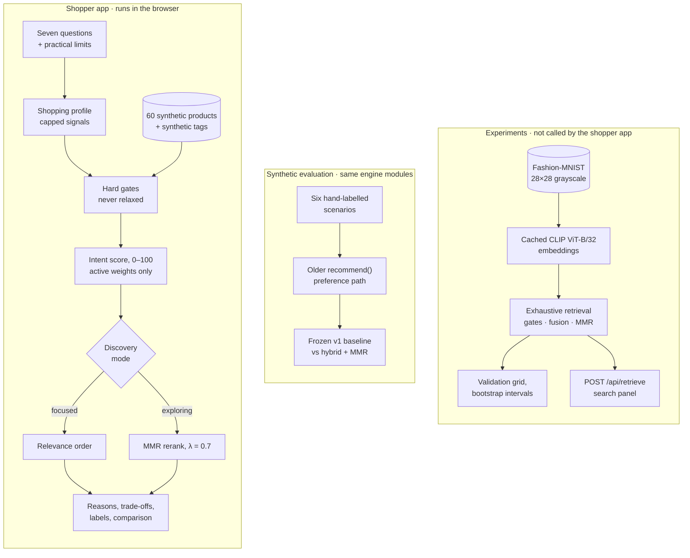

<div align="center">

# FitRank
### Fashion discovery, ranked by intent.

A purchase has a reason. FitRank turns that reason into a profile, ranks a synthetic catalogue against it, and keeps the trade-offs visible.

`Vanilla JavaScript` · `Explainable ranking` · `Offline evaluation` · `Separate CLIP experiments`

[How it works](#how-fitrank-works) · [Architecture](#architecture) · [Evaluation](#experiments-and-evaluation) · [Getting started](#getting-started) · [Status](#current-status)

</div>

FitRank is an exploration of intent-aware fashion recommendation. It asks what prompted the purchase, what would make it feel worth it, how the piece should sit in a wardrobe, where it will be worn, which aesthetics appeal, and which trade-offs matter when several options are good. Those answers become a structured shopping profile. Practical limits act as hard constraints. Products that pass are scored with a transparent weighted model, reordered for variety when the shopper is exploring, and returned with reasons, trade-offs, and a plain statement of what the system could not know.

This is a decision-support and technical-experimentation project. It is not a retailer and not a deployed recommendation service. The 60-product catalogue is synthetic, including its brands, prices, and ratings. A separate track evaluates CLIP image and text retrieval on Fashion-MNIST. That track does not feed the shopper ranking.

## Preview

<!-- Screenshot placeholder: add a capture of the questionnaire and a ranked shortlist (for example docs/images/shortlist.png) once one exists. The repository has no application screenshots yet. -->

One answer set, run through `recommendFromIntent()` on the built-in catalogue. The text is shortened. Each sentence is the engine’s own. Component figures are the points each signal contributes to the 0–100 score.

```text
Answers    Something in my wardrobe is missing · I'll wear it again and again
           A versatile piece · I know what I need · University and work
           Minimal · Comfort and quality
Limits     Loafers or flats · ₹8,000 per item · in stock only

Profile    A versatile wardrobe addition, relevance order
Eligible   6 of 60 (14 over budget, then 40 outside the chosen categories)

1  Leather Loafer · Harbour Lane · ₹7,100                  90 / 100   Best overall match
   context 30.5 · aesthetic 15.8 · comfort 15.0 · wardrobe role 15.0 · quality 13.4
   + Ranked highly because it fits your selected aesthetic and works for several
     of your intended settings.
   + Synthetic review estimate 4.58 from 150 reviews. Not verified customer
     sentiment, and not a lifespan test.
   - Your existing wardrobe was not provided, so this does not claim to know
     what you already own.
   - A stronger choice for the versatility priority, and less distinctive than
     other options.

2  Black Leather Loafer · Harbour Lane · ₹7,300            81 / 100
3  Penny Loafer · Northline · ₹6,400                       80 / 100
```

## The problem

A filter can tell you which loafers cost less than ₹8,000. It cannot tell you whether a loafer is the right purchase.

The same black leather loafer is a strong answer for “replace the pair I wear to class every day” and a weak one for “something that makes a wedding feel special”. Category, colour, and budget do not separate those two shoppers. What separates them is the reason for buying, the role the piece should play, the settings it has to cover, and the trade-offs the shopper will accept.

Intent also mixes two kinds of statement. Some are limits: a budget, a size, “nothing synthetic”. Others are preferences that compete: versatility against distinctiveness, comfort against making a statement. Treat a limit as a preference, and unsuitable products come back in. Treat a preference as a limit, and the shortlist can end up empty.

FitRank is a working attempt at that translation, built around three questions:

- How can open-ended shopping answers become a profile that is deterministic and open to inspection?
- How should hard constraints, soft preferences, and diversity interact in one ranking?
- How can each recommendation be explained honestly, including what the system does not know?

## How FitRank works

The shopper page calls one pure function, `recommendFromIntent()` in `js/shopping/recommendIntent.js`. The browser and the tests import the same ES modules. [`PLAN.md`](PLAN.md) is the reference for every formula.

### 1. Ask about the purchase

There are seven questions. Four take one answer: what prompted the purchase, what would make it worth it, the piece’s role in the wardrobe, and how focused the search should be. Three take several answers: where it will be worn, which aesthetics appeal, and which trade-offs matter. Practical limits follow: a per-item or total budget, categories, size, and stock, plus optional colour, material, fit, season, dress code, brand, and features to avoid. A review step lists everything before the search runs.

### 2. Interpret a shopping profile

`interpretShoppingProfile()` adds up the effects that each option declares as data in `js/shopping/vocabulary.js`. Each signal is capped at 2, so three answers that all point to versatility do not triple its weight. The answers also vote for a mission label, such as “Fill a wardrobe gap”. Answers that ask to explore, discover, or compare switch the ranking to diversity mode. “A balance of several of these” sets the trade-offs the shopper did not pick to a shared level of 0.5. It does not add a bonus. A “flattering fit” priority is recorded and deliberately not scored, because the catalogue has no fit measurement. No model is called, so the same answers always give the same profile.

`js/intent/buildIntent()` can also wrap those answers in a typed `IntentProfile`: hard limits, soft preferences, provenance, and a sentence from the fixed templates in `js/intent/templates.v1.json`. `rankFromIntent()` restores the answers and calls `recommendFromIntent()`. The page does not use this wrapper yet, and the sentence is not an input to ranking.

### 3. Apply hard constraints

Gates run before any scoring and never award points. `generateCandidates()` drops malformed rows and applies budget, stock, and size. A price equal to the budget passes. `applyShoppingGates()` then applies any category, colour, material, fit, brand, season, dress-code, or avoid rule the shopper set. A missing attribute fails an active gate. Gates are never relaxed to fill a list: an empty result names the limiting constraint and how many rows each gate removed. Where a gate relies on a stand-in, such as a silhouette label for fit or wool and linen for season, the result says so.

### 4. Score what passes

`scoreIntentProduct()` computes component values from 0 to 1 and combines only the components the answers activate:

```text
score = round(100 × Σ(weight × value) / Σ(active weights))
```

| Component | Base weight | Read from |
| --- | ---: | --- |
| Context | 26 | Catalogue occasions for the chosen settings, plus formality fit |
| Aesthetic | 18 | Synthetic aesthetic tags with graded relevance, averaged over the chosen aesthetics |
| Value | 16 | Geometric mean of the review-based quality estimate and room under the budget |
| Versatility | 14 | Versatility rating, or the number of occasions when the rating is absent |
| Distinctiveness | 14 | Bold or artistic styles, rarity, and how distinctive the aesthetic is |
| Comfort | 12 | Comfort rating |
| Quality | 12 | Bayesian-smoothed synthetic rating |
| Wardrobe role | 12 | A role-specific reading of the signals above |
| Price | 6 | Room under the budget, used only when value is inactive |
| Similarity | 16 | Attribute similarity to a “More like this” item |
| Avoid | 14 | One minus the highest similarity to any “Less like this” item |

Trade-off weights are multiplied by the capped preference level, so a stronger stated priority counts for more without being counted twice. If the wardrobe role already reads versatility or distinctiveness, the separate component for that signal is switched off. A missing attribute scores 0. Synthetic ratings are smoothed toward the catalogue mean, weighted by review count, with m = 10, so a 5.0 from 2 reviews does not beat a 4.2 from 200.

### 5. Order the shortlist

Focused answers keep relevance order: score, then product id. Answers that ask to explore, discover, or compare use maximal marginal relevance (MMR):

```text
MMR(d) = λ × score(d)/100 − (1 − λ) × max similarity(d, already chosen),   λ = 0.7
```

Similarity is a weighted attribute match: category 0.35, style 0.20, colour, material, silhouette, and occasion 0.10 each, and comfort 0.05. The penalty is for redundant style. With a total budget, products are added in ranked order, and any product that would exceed the remaining budget is skipped. Up to five skipped products are shown as alternatives, with the reason.

### 6. Explain

Each result carries per-component contributions, reasons, trade-offs, constraint notes, and decision labels. Sentences are built only from recorded components and catalogue fields. Missing data is named, synthetic tags are labelled as synthetic, and no discount, lifespan, or knowledge of the shopper’s wardrobe is invented. The labels are Best overall match, Most versatile, and Closest to the selected item. Each goes only to an outright winner. Ties get none. Best overall match is withheld when the top score is below 60.

From the results, a shopper can compare up to three products, ask for “More like this” or “Less like this”, list attribute-similar items, or import a JSON or CSV catalogue for the current session. Nothing is stored. FitRank does not learn from past shoppers.

### Terms used precisely

- **Similarity** means related attributes. It does not mean the same item or a duplicate listing.
- **Value** and **budget fit** combine the smoothed review estimate with room under the shopper’s budget. Neither is a fair-price judgement.
- **Weighted similarity, Bayesian smoothing, and MMR** are transparent formulas. They are not a trained model.

<details>
<summary><strong>The original preference engine, <code>recommend()</code></strong></summary>

<br>

`recommend(products, preferences)` in `js/recommend.js` is the FitRank 2.0 engine. It takes an explicit preference object — occasions, styles, colours, materials, emphasis, budget, size, stock, and an optional reference product — instead of questionnaire answers. The page no longer opens on it. It drives the synthetic evaluation and is fully tested.

```text
validatePreferences → generateCandidates → scoreProduct → rankByRelevance or rerankMMR → assignLabels → buildExplanation
```

| Component | Weight | How it is scored |
| --- | ---: | --- |
| Occasion | 24 | 0.7 × occasion overlap + 0.3 × formality fit |
| Style | 16 | Overlap with selected styles. Any disliked style scores 0 |
| Colour | 8 | 0 if disliked or missing, 1 on a preferred match |
| Comfort | 14 | Comfort rating / 5 |
| Versatility | 14 | Versatility rating / 5, otherwise occasions / 4, capped at 1 |
| Quality | 12 | (smoothed rating − 1) / 4 |
| Budget fit | 12 | Mean of the quality component and budget headroom |

Optional components are similarity (16), material (10), and statement (10). An emphasis doubles comfort, versatility, quality, or budget fit, or multiplies style and colour by 1.6 for appearance. Flexible preferences halve style and colour and multiply comfort and versatility by 1.25. Formality targets are everyday 2, travel 2, work 4, evening 5, and special 5. Formality fit is `1 − |rating − target| / 4`. The frozen v1 scorer in `js/baseline.js` also gave every product that passed the category gate full category credit. It is kept only so the evaluation can compare both scorers on the same candidates.

</details>

## Architecture

The shopper path and the visual-retrieval path do not call each other.



`buildIntent()` sits beside the shopper path. It records the same answers as an `IntentProfile` and a template sentence. The page still calls `recommendFromIntent()` directly, and nothing embeds that sentence.

The shopper path runs in the browser with no installed libraries. Node serves the files and runs the tests. `server.js` has a single API route, `POST /api/retrieve`, and only the experimental image and text panel uses it. The experiments install `@huggingface/transformers` in their own folders, `prototypes/moodboard/` and `ml/`, so the root package stays dependency-free.

| Path | Contents |
| --- | --- |
| `index.html`, `css/`, `js/main.js` | Page shell and panel wiring |
| `js/shopping/` | Questionnaire vocabulary and flow, profile interpreter, shopping gates, intent scorer, explanations, results page |
| `js/intent/` | Typed `IntentProfile`, query templates, and an adapter back to `recommendFromIntent()` |
| `js/` (top level) | Shared engine: catalogue and import, candidates, quality, similarity, ranking and MMR, labels, `recommend()`, metrics, evaluation, benchmark, and helpers for the first retrieval experiment |
| `experiments/` | First Fashion-MNIST retrieval experiment, its protocol, and the search behind `/api/retrieve` |
| `js/retrieval/`, `ml/`, `configs/` | Sprint retrieval core, embedding cache, validation harness, and frozen config |
| `prototypes/moodboard/` | Original 40-image CLIP trial |
| `data/` | Sample import file and hand-labelled multi-seller listing pairs |
| `test/` | `node:test` suites and hand-labelled scenarios |
| `server.js` | Zero-dependency static server |
| `PLAN.md`, `PROGRESS.md`, `docs/` | Design reference, dated progress log, audit, task list |

## Technical features

- **Answers as data.** Every option declares its effects in one vocabulary file. The interpreter adds them up and caps them, so adding an option or an aesthetic does not require a new branch in the ranker.
- **Constraints that hold.** Hard gates run before scoring. Missing data fails an active gate. An empty result explains which constraint emptied it. Benchmarks and randomised tests check for zero violations.
- **Scoring you can inspect.** Only the components the answers activate are renormalised into the score. Each contribution is reported. Ties break by id.
- **Diversity as a choice.** Exploratory answers switch on MMR. The evaluation reports the cost when that reordering loses precision.
- **Explanations with a boundary.** Missing data is named. Synthetic data is labelled. Wardrobe knowledge is never assumed. “Flattering fit” is collected and left unscored.
- **A typed profile, not yet the page’s entry.** `IntentProfile` records which answer produced which field and renders a deterministic query sentence. Ranking still uses the questionnaire interpreter.
- **Session tools.** Three-way comparison, “More like this” and “Less like this”, attribute-similar items, total-budget packing, and validated session-only JSON or CSV import.
- **Reproducible retrieval experiments.** Source files are checked against published checksums. Splits are seeded and checked for leaked duplicate images. Embedding caches are keyed by content hash. The selection rule was written before tuning, the chosen config is frozen by hash, and the harness refuses to score the test split.
- **A zero-dependency runtime.** The app and its tests use Node.js built-ins. Machine-learning tooling lives in separate packages.

## Experiments and evaluation

Every number below is offline. Each one comes from a committed result file, a dated log, or a script that can be re-run. None of them comes from real shoppers. Read each result against what it actually measures.

### Synthetic shopper scenarios

**What it measures.** Whether hand-labelled relevant products reach the top 5 in six scripted scenarios, compared with the frozen v1 baseline on the same candidate set. The labels in `test/fixtures/scenarios.js` were written from product attributes, and that file does not import the ranker. The baseline uses the v1 score in relevance order. The hybrid uses the 2.0 score with MMR at λ = 0.7. K = 5.

**Scope.** This harness tests the older `recommend()` path, not the questionnaire path.

| Scenario | P@5 baseline | P@5 hybrid | NDCG@5 baseline | NDCG@5 hybrid | Diversity baseline | Diversity hybrid |
| --- | ---: | ---: | ---: | ---: | ---: | ---: |
| Strict budget and category | 0.600 | 0.600 | 1.000 | 1.000 | 0.435 | 0.435 |
| Comfort and versatility | 0.800 | 0.400 | 0.853 | 0.692 | 0.738 | 0.795 |
| Similar to a reference loafer | 0.800 | 0.800 | 0.758 | 0.963 | 0.447 | 0.447 |
| Conflicting soft preferences | 0.800 | 0.600 | 0.761 | 0.610 | 0.728 | 0.713 |
| Few eligible products | 0.200 | 0.200 | 1.000 | 1.000 | — | — |
| No eligible products | — | — | — | — | — | — |

These quality figures were recorded on 12 Oct 2026 and matched again on 14 Oct 2026, to the published rounding. Diversity reranking is a trade-off. On the comfort scenario, intra-list diversity rose from 0.738 to 0.795 while precision fell from 0.800 to 0.400. On the reference-loafer scenario, NDCG rose from 0.758 to 0.963. Conflicting tastes lost on every measure.

Hard-constraint violations were 0 on every non-empty list. Catalogue coverage is 0.983 for both strategies. Broad scenarios return almost the whole in-stock catalogue, and MMR only reorders it, so coverage cannot show a diversity effect.

Across the six scenarios, the hybrid takes a few hundred milliseconds where the baseline takes a few milliseconds, because it reranks and explains every eligible row. Those times were recorded on 12 Oct 2026, depend on the machine, and are not a quality measure. **Run synthetic evaluation** on the page runs the same suite in the browser.

### Candidate generation at scale

`runCandidateBenchmark()` times the exhaustive scan for a fixed shopper: ₹8,000, Handbags and Sneakers, in stock, size `one-size`. The 1,000-row and 10,000-row catalogues are generated fixtures, not additional listings.

| Catalogue | Rows | Runtime (12 Oct 2026) | Candidates | Gate violations |
| --- | ---: | ---: | ---: | ---: |
| Published | 60 | 0.61 ms | 7 | 0 |
| Synthetic | 1,000 | 1.85 ms | 28 | 0 |
| Synthetic | 10,000 | 13.06 ms | 280 | 0 |

A re-run on 14 Oct 2026 kept the candidate counts and zero violations. The millisecond timings moved, as a local clock will. The exhaustive scan is the baseline any future retriever would be compared against.

### The questionnaire path

The questionnaire path has no offline relevance metric yet. `test/shopping-intent.test.js` checks behaviours that should hold:

- A versatile everyday piece outranks a party piece for a versatile mission, and a distinctive piece outranks a basic for a statement search.
- A low price does not outrank a better-supported deal, and a cheap, unsuitable product stays below a suitable one.
- Aesthetic matches earn partial, unequal credit, and missing attributes never count as matches.
- Changing answers changes the order, and exploratory answers trigger the diversity rerank.

`test/intent-profile.test.js` checks the typed profile: every questionnaire option maps to a signal or is listed as unused (`priorities:fit` is the unused one), missing answers stay null, the same answers always produce the same query sentence, and ten stored answer sets match `recommendFromIntent()` exactly.

[`PLAN.md`](PLAN.md) designs a blind, pooled human-judgement protocol for this path. It has not been run.

### Fashion-MNIST retrieval (experimental)

**What it measures.** Whether a query image or text retrieves index images of the same Fashion-MNIST garment class. The images are 28×28 grayscale across 10 classes. A hit is a matching class label. It does not measure shopper relevance, aesthetic understanding, or real-world fashion quality.

These experiments exercise retrieval machinery — embedding caches, gates, fusion, MMR, and metrics — on labelled data. They are not connected to the shopper ranking.

**First slice.** The data is 1,000 index images, 100 validation queries, and 100 test queries from the Fashion-MNIST test set. The model is CLIP ViT-B/32, 8-bit, on CPU, with K = 10. The protocol in [`experiments/PROTOCOL.md`](experiments/PROTOCOL.md) was fixed before the test split was scored. Recall@10 cannot exceed 0.10, because each class has 100 index images. Results on the test queries, from [`experiments/retrieval-results.json`](experiments/retrieval-results.json):

| Query type | Method | Precision@10 | NDCG@10 |
| --- | --- | ---: | ---: |
| Image, 100 queries | Seeded random | 0.094 | 0.091 |
| Image, 100 queries | Pixel cosine | 0.684 | 0.704 |
| Image, 100 queries | CLIP image | 0.721 | 0.733 |
| Class-name text, 10 queries | Lexical overlap | 0.900 | 0.900 |
| Class-name text, 10 queries | CLIP text | 0.630 | 0.618 |
| Paraphrased text, 10 queries | Lexical overlap | 0.800 | 0.800 |
| Paraphrased text, 10 queries | CLIP text | 0.800 | 0.815 |
| Image + paraphrase, 100 queries | Hybrid | 0.766 | 0.782 |

- CLIP beat pixel cosine overall, and not on every class. On coats, pixel cosine scored 0.580 against CLIP’s 0.510. CLIP was weak on shirts, at 0.340.
- Literal class-name text favoured lexical overlap.
- The hybrid landed between its two signals, and below text alone.
- Reranking the top 50 for diversity lowered precision from 0.766 to 0.730 and raised pixel-space diversity from 0.188 to 0.217.
- Ranking 1,000 cached vectors took about 5 ms. The first embedding pass took 49.3 ms per image on CPU.

**Validation grid.** A fresh seeded split, built from checksum-verified source files: 2,000 index and 300 validation images from the training set, and 500 test images from the test set, with no shared pixel hashes. Seventy-one configurations were scored on validation only: image, text, pixel, lexical, and hybrid retrieval, varying preprocessing, prompt template, fusion method (z-score against reciprocal rank fusion), and fusion weight. Three MMR λ values were then tried on the chosen hybrid. The selection rule was written before the runs. Results are macro NDCG@10 with 95% bootstrap intervals over queries (1,000 resamples), from [`ml/results/val/summary.md`](ml/results/val/summary.md). On this split each class has 200 index images, so Recall@10 cannot exceed 0.05. The frozen arm’s Recall@10 was 0.040.

| Arm | Macro NDCG@10 | 95% interval |
| --- | ---: | --- |
| Hybrid image + text, frozen config | 0.798 | 0.786–0.809 |
| CLIP image | 0.758 | 0.734–0.781 |
| CLIP text, best template | 0.724 | 0.631–0.809 |
| Pixel cosine, mean-centred | 0.705 | 0.677–0.733 |
| Lexical overlap | 0.667 | 0.475–0.850 |

- Z-score fusion beat the matching reciprocal-rank-fusion arm by 0.024 NDCG@10. The paired interval was 0.017 to 0.031.
- The rule selected λ = 0.9. The diversity gain was negligible, and the interval for the NDCG change includes 0. That is not evidence that MMR improved the lists.
- For the frozen arm, coat (0.526) and shirt (0.532) remain the weakest classes.
- The arms use different query lists: 900 image–text pairs, 300 images, and 30 text queries. Only the fusion comparison is a paired test.
- The frozen configuration is [`configs/frozen.v1.json`](configs/frozen.v1.json). Its held-out test split has not been scored.

**Smaller studies.**

- The moodboard trial in [`prototypes/moodboard/`](prototypes/moodboard/README.md) ran 10 inspiration images against 30 candidates. Mean Precision@3 was 0.500, against a chance level of 0.100. That is above chance, from ten queries.
- [`data/listings/`](data/listings/) holds 18 fictional multi-seller listings and 13 hand-labelled pairs: probable duplicate, attribute conflict, similar style, or unrelated. Exact name plus declared fields classified 12 of the 13 pairs correctly. CLIP name similarity at a fixed 0.90 cutoff classified 10 correctly, because similar-style names scored above the cutoff. The 13 pairs are the whole set. There is no held-out split. This is a smoke test, not an estimate.

## Tech stack

**Shopper app**

- HTML, CSS, and vanilla JavaScript ES modules, with no framework and no build step
- A static server using only Node.js built-ins (`http`, `fs`, `path`)
- `node:test` for the test suite
- No npm dependencies, database, or external API

**Experimental tooling**, in separate `package.json` files

- Transformers.js (`@huggingface/transformers`, pinned to 4.3.1 in `ml/`) in `prototypes/moodboard/` and `ml/`
- CLIP ViT-B/32 (`Xenova/clip-vit-base-patch32`), 8-bit quantised, CPU inference, 512-dimensional embeddings
- Fashion-MNIST from Zalando Research, under the MIT License
- A plain-JavaScript retrieval core in `js/retrieval/` (exhaustive top-k, fusion, MMR, metrics, bootstrap), plus Node `zlib` and `crypto` for reading the dataset files, verifying checksums, and hashing caches

## Getting started

**Requirements.** Node.js 22 is what this project is developed and tested on (v22.20.0). `package.json` declares no `engines` field. The test suite uses JSON import attributes (`with { type: "json" }`), which Node.js releases before 18.20 and 20.10 do not support. The app needs no `npm install`.

```bash
git clone https://github.com/arhennia/FitRank.git
cd FitRank
npm start
```

Then open [http://127.0.0.1:5173](http://127.0.0.1:5173). `node server.js` is the same command. Set `PORT` to use another port:

```bash
PORT=8080 npm start            # macOS and Linux
$env:PORT = 8080; npm start    # Windows PowerShell
```

Open the app through the server. Most browsers block ES module imports from `file://`.

The page has four parts:

- The shopping questionnaire and its results
- An image and text search panel
- A report of the saved retrieval experiment
- A button that runs the synthetic evaluation in the browser

Everything except the image and text search panel works after cloning. Until the optional setup below has been run, that panel reports that the retrieval embeddings are not cached.

### Optional: reproduce the retrieval experiments

These steps install Transformers.js in their own folders and download the Fashion-MNIST files and the CLIP weights once. They regenerate the committed result files.

```bash
# CLIP runtime and model weights, cached in prototypes/moodboard/.cache
cd prototypes/moodboard
npm install
node prepare.mjs
node retrieve.mjs
cd ../..

# First retrieval slice; also builds the index behind POST /api/retrieve
npm run prepare-mnist
npm run embed-retrieval
npm run evaluate-retrieval

# Validation grid (reuses the cached weights)
cd ml
npm install
cd ..
npm run ml:split
npm run ml:embed -- --target images --variant all
npm run ml:embed -- --target paraphrase
npm run eval:val
```

Restart `npm start` after embedding so `/api/retrieve` loads the new index. `npm run eval:arm -- --config configs/exp/<arm>.json --split val` scores a single configuration. Both evaluation commands refuse `--split test`.

## Testing

```bash
npm test                                   # node --test
node --test test/shopping-intent.test.js   # one suite
node --test test/intent-profile.test.js
```

On 14 Oct 2026, `npm test` reported 141 tests, 0 failed, 0 skipped. The suite needs no network access and does not download model weights. One integration test re-embeds 20 images when the local CLIP cache exists. Without the cache, it skips with `SKIPPED: model unavailable`.

| Area | Suites | What is checked |
| --- | --- | --- |
| Shopper questionnaire | `shopping-intent` | Question wording and validation, navigation, profile interpretation, ranking behaviours, shopping gates, per-item and total budgets, compatibility with the older engine and import |
| Intent profile | `intent-profile` | Option coverage, unused answers, null handling, stable query text, and identical rankings on 10 stored answer sets |
| Ranking engine | `engine`, `similarity`, `quality`, `diversity` | Catalogue integrity, gate order and diagnosis, budget equality, renormalised scoring, missing attributes, explanations, the comparison cap, JSON and CSV import, similarity, Bayesian smoothing, MMR against λ = 1, unique labels |
| Evaluation | `evaluate`, `benchmark` | Metric arithmetic, the six scenarios, candidate generation at 60, 1,000, and 10,000 rows with zero violations |
| Retrieval | `retrieval`, `retrieval-core`, `retrieval-metrics`, `text-queries` | Protocol constants, gates under 1,000 random constraint combinations and a gate-violating item at similarity 1.0, fusion and renormalisation when a signal is missing, MMR, metrics against hand-computed values, bootstrap, the selection rule, the text-query split |
| Data and caches | `fmnist-split`, `embed-cache`, `embed-integration`, `listings`, `moodboard-labels` | Dataset file parsing and truncation, deterministic seeded splits, leaked-duplicate checks, cache reuse and invalidation, the hand-labelled sets |

## Current status

FitRank 2.0 is complete. Work on 2.1 is under way. The governing rule in [`PLAN.md`](PLAN.md) puts every component in one of two groups. Integrated components are called in the search path and have an evaluation arm. Labelled experiments carry no claims about shoppers.

| Component | Status |
| --- | --- |
| Questionnaire, profile, gates, intent scoring, MMR, explanations | Running in the shopper app |
| `recommend()` preference engine and synthetic evaluation | Working. Drives the evaluation, not the questionnaire |
| Typed `IntentProfile` and query templates (`js/intent/`) | Built and tested. The page does not call it, and the query text is not retrieved against |
| Fashion-MNIST CLIP retrieval and the `/api/retrieve` panel | Experiment, in a separate page panel |
| Retrieval core, validation grid, frozen config (sprint tasks T1–T4) | Experiment. The test split has not been scored |
| CLIP embeddings of catalogue text | Cached. Not used for ranking |
| Listing matching on 13 pairs | Experiment |
| Integrated catalogue search, persona evaluation, `/api/search` | Planned |

The gaps that matter:

- The questionnaire path does not call any embedding retriever. It ranks on catalogue attributes.
- The synthetic evaluation measures the older `recommend()` path. The questionnaire path is covered by behavioural tests, not relevance metrics.
- No result yet comes from human judgements.
- The frozen retrieval config has not been scored on its held-out test split.
- `docs/plan/TASKS.md` still lists the intent-profile task as open, even though `js/intent/` and its tests are in the tree. Integrated search has not started.

[`PROGRESS.md`](PROGRESS.md) is the dated log. [`docs/plan/TASKS.md`](docs/plan/TASKS.md) tracks the sprint.

## Limitations

- **Synthetic catalogue.** Sixty hand-written fictional products, with illustrative INR prices, synthetic ratings, and synthetic review counts, one listing per product. It is not a retailer feed. With several limits set, only a handful of products may be eligible.
- **Synthetic annotations.** The finer categories and aesthetic tags on the questionnaire path were written for this demo, and coverage is uneven. Grunge, fairycore, and Y2K have no tagged products. Goth has one. The Boots category matches no products. Those answers cannot separate the catalogue. Minimal, by contrast, is tagged on 28 products.
- **Hand-set weights.** Scores come from transparent rules. No weight was learned from shopper data.
- **What the system cannot know.** There is no wardrobe data, fit measurement, price history, or verified review text. The engine says so. The “flattering fit” priority is not scored.
- **Offline metrics are not user relevance.** The scenario labels were written by the project author from product attributes. Fashion-MNIST metrics measure class match on 28×28 grayscale images. None of these results is a user study, and no online experiment has been run.
- **Not yet integrated.** CLIP retrieval, the catalogue text embeddings, the intent query sentence, and listing matching do not affect shopper rankings. The image index has no price, size, or stock data, so requests that use those limits fail instead of inventing values.
- **Session only.** There are no accounts, saved searches, cart, or checkout. Feedback and imports last for the current page load.

## Roadmap

These milestones follow the revised 2.1 plan in [`PLAN.md`](PLAN.md). The typed profile is the part already in the tree. The rest is still ahead.

1. **Make the profile the search input.** `IntentProfile` already maps answers to hard limits, soft preferences, provenance, and a template sentence, and fixture tests keep today’s rankings unchanged. The page still enters through the questionnaire interpreter, and the sentence is unused.
2. **Integrated catalogue search.** Fuse the attribute scorer with text-embedding similarity between that sentence and the catalogue text. Gates run before scoring and are checked again on the output. A search with no query must match the current ranking exactly.
3. **Shopper-task evaluation.** Twenty-four personas, split before any run. Pooled results judged blind against a rubric written in advance, reported as graded NDCG@5 with bootstrap intervals. An influence test flags any answer that never changes the ranking. Judgements are a human step. They are not filled in by code.
4. **One held-out Fashion-MNIST test run** of the frozen config, logged. The test split stays unscored until that run.
5. **Service and interface.** A `/api/search` route with a dataset field and a fallback when the model is unavailable. Explanations that show which answers drove which signal. Fashion-MNIST moved to a clearly labelled lab tab. A components ledger checked by script.
6. **A real catalogue, only after the licence is checked.** Map it to the questionnaire vocabulary and re-run persona judging with at least 40 personas and a second judge. A learned ranker would be considered only after about 1,000 judged pairs exist.

## Contributing and feedback

Bug reports, critiques of the scoring or the evaluation design, and other technical discussion are welcome, especially from people who work on recommendation, retrieval evaluation, or fashion.

- **Bugs.** Open an issue with the answers and limits you used, what you expected, and what FitRank returned. The review step on the page lists them.
- **Design questions.** Issues are the right place to argue with a weight, a gate, or a metric. [`PLAN.md`](PLAN.md) records the formulas and the reasoning.
- **Pull requests.** Keep the root app dependency-free, run `npm test`, and report a measured number as measured, including when a change makes it worse.

## License

This repository has no license file, so no open-source license has been granted for the code. Fashion-MNIST is © 2017 Zalando SE and is used under the MIT License. The text is in [`ml/data/fashion-mnist-LICENSE.txt`](ml/data/fashion-mnist-LICENSE.txt).
