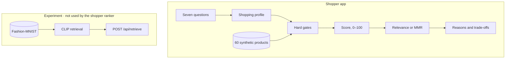

<div align="center">

# FitRank
### Fashion discovery, ranked by intent.

Shopping filters stop at category, colour, and budget. FitRank asks why you are buying, turns those answers into a profile, and ranks a synthetic catalogue with the trade-offs left in the open.

Vanilla JavaScript · Explainable ranking · Offline evaluation

[How it works](#how-it-works) · [Results](#experiments-and-results) · [Run locally](#run-locally)

</div>

A decision-support experiment, not a shop. The catalogue is 60 fictional products. A separate CLIP track on Fashion-MNIST does not feed the ranking.

## Preview

<!-- Add a screenshot of the questionnaire and shortlist here once one exists. No application screenshot is in the repository. -->

```text
Wardrobe gap · wear it again · versatile · university and work
Minimal · comfort and quality · loafers or flats · ₹8,000 · in stock

Leather Loafer · Harbour Lane · ₹7,100     90 / 100   Best overall match
  Fits the chosen aesthetic and settings.
  Synthetic rating 4.58 from 150 reviews. Does not know what you already own.
```

## How it works

1. **Intent.** Seven questions cover why you are shopping, what would make the purchase worth it, the wardrobe role, how focused the search is, where it will be worn, which aesthetics appeal, and which trade-offs matter.
2. **Profile.** Each option declares its effect in `js/shopping/vocabulary.js`. Signals are capped, so repeated answers cannot stack forever. The same answers always yield the same profile.
3. **Constraints.** Budget, stock, size, and any category or attribute limits run before scoring. They are never relaxed to fill a shortlist.
4. **Rank.** `recommendFromIntent()` scores only the signals those answers turn on, from 0 to 100. The formulas are in [PLAN.md](PLAN.md).
5. **Diversity.** Exploratory answers rerank with maximal marginal relevance (λ = 0.7). A focused search stays in score order.
6. **Explain.** Each row gives reasons, trade-offs, and what the catalogue cannot know, including the shopper’s existing wardrobe.



## Key features

- Option effects are data. Adding an aesthetic does not require a new branch in the ranker.
- Hard gates fail closed. A missing attribute does not slip through an active constraint.
- The score uses only the signals the answers activated, then renormalises.
- Explanations quote recorded fields. Synthetic ratings stay labelled as synthetic.
- Comparison, “more like this”, and catalogue import last for the session. Nothing is stored, and the ranker does not learn.
- Retrieval experiments keep checksums, seeded splits, and a frozen config. The harness refuses to score the held-out test split.

## Experiments and results

These numbers are offline. The shopper scenarios were labelled from product attributes by the project author, and they exercise the older `recommend()` path, not the questionnaire. Fashion-MNIST measures whether a 28×28 image retrieves the same garment class. Neither is a user study. Full tables are in [PROGRESS.md](PROGRESS.md), [experiments/PROTOCOL.md](experiments/PROTOCOL.md), and [ml/results/val/summary.md](ml/results/val/summary.md).

| Experiment | What it measures | Result |
| --- | --- | --- |
| Six synthetic scenarios, K = 5 | Precision against a frozen baseline | On the comfort scenario, diversity reranking moved P@5 from 0.80 to 0.40 and diversity from 0.74 to 0.80. Gate violations were 0. |
| Fashion-MNIST images, 100 test queries, K = 10 | Same garment class | CLIP precision 0.721, pixel cosine 0.684, random 0.094. |
| Frozen hybrid, validation only | Macro NDCG@10 on class match | 0.798 (interval 0.786–0.809). The held-out test split has not been scored. |

## Tech stack

| | |
| --- | --- |
| Shopper app | HTML, CSS, and vanilla ES modules. A Node static server. No npm dependencies and no build step. |
| Tests | Node’s built-in test runner |
| Experiments | Transformers.js and CLIP ViT-B/32 in `ml/` and `prototypes/moodboard/`. The retrieval maths itself is plain JavaScript. |

## Run locally

Developed on Node.js 22 (v22.20.0). No install step.

```bash
npm start
```

Open [http://127.0.0.1:5173](http://127.0.0.1:5173). Serve the files; opening `index.html` directly blocks ES modules in most browsers.

```bash
npm test
```

The image-search panel stays quiet until the optional CLIP setup in [PROGRESS.md](PROGRESS.md). Until then it reports that the embeddings are not cached.

## Status and limitations

The live path is the questionnaire, the gates, the score, diversity reranking, and the explanations. A typed `IntentProfile` in `js/intent/` is tested. The page does not call it, and its query sentence is not used for retrieval.

- Brands, prices, and ratings in the catalogue are fictional.
- CLIP retrieval, catalogue-text embeddings, and the listing-match trial do not change shopper rankings.
- No learned ranker, and no judgements from shoppers.
- The repository has no license file, so the code is not offered under an open-source license. Fashion-MNIST is used under the MIT text in `ml/data/fashion-mnist-LICENSE.txt`.

## Roadmap

The next milestones in [PLAN.md](PLAN.md):

1. Make the typed profile the input to search, including its template sentence.
2. Fuse attribute scores with similarity to catalogue text, with gates still applied first.
3. Run a blind judged evaluation on personas, and score the frozen Fashion-MNIST config once on its held-out split.
4. Consider a real catalogue only after its licence is checked.

## Contributing

Bug reports and arguments about the scoring or the evaluation are welcome. Include the answers you used and what FitRank returned. Keep the root app free of dependencies, and run `npm test` before a pull request.
